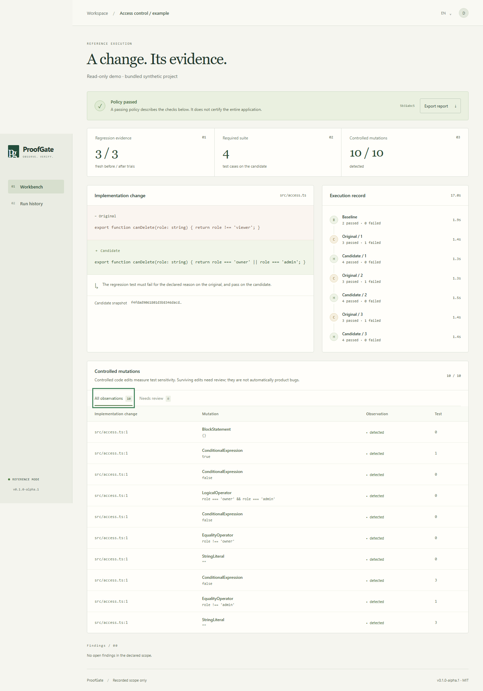

# ProofGate

**Değişiklik ve kanıtı.** Claude Code, Codex veya editörünüzle yazdığınız kod için eski/yeni test karşılaştırması ve kontrollü hata denemeleri.

[Canlı demo](https://proofgate-demo.onrender.com/) · [English](README.md) · [Kurulum](docs/SETUP.tr.md) · [Mimari](docs/ARCHITECTURE.md) · [Güvenlik](SECURITY.md)

Ajan bir yetki kontrolünü düzeltip test ekleyebilir; eklenen test bozuk kodda da geçiyor olabilir. ProofGate aynı testi iki sürümde çalıştırarak bunu görünür kılar. Ardından StrykerJS ile küçük kontrollü hatalar oluşturup testlerin bunları yakalayıp yakalamadığını inceler. Rapor tam kaynak, bağımlılık, politika ve çalışma imajı kimliğine bağlıdır.



## Özellikler

- Bir başlangıç denemesi ve üç taze eski/yeni karşılaştırması.
- Ağ erişimi kapalı; süre, bellek ve CPU sınırları bulunan Docker denemeleri.
- Değişen kaynak aralığında, başlamadan önce sayısı sınırlandırılan mutasyonlar.
- Silinen zorunlu testler, `skip/only/todo` ve değişen test ayarları için bulgular.
- CLI, gerçek MCP sunucusu, Türkçe/İngilizce arayüz ve indirilebilir rapor.
- Yerelde hesapsız kullanım; ayrıca roller, davetler, süreli proje anahtarları ve operatör kurtarması içeren ekip modu.

Temel doğrulama **model API anahtarı, ücretli servis veya bulut hesabı istemez**. MIT lisanslı bir alpha sürümüdür. Politikanın geçmesi sınanan kapsamı gösterir; tüm uygulamanın hatasızlığını veya güvenliğini belgelemez.

## Başlangıç

Node.js 24 serisinde **24.15 veya üzeri**, npm, Git ve çalışan bir Docker Linux motoru gerekir. Windows'ta Docker Desktop Linux-container modunu kullanın.

```sh
git clone https://github.com/nexora-studio-tr/proofgate.git
cd proofgate
npm run setup
npm start
```

İlk komut bağımlılıkları kilit dosyasından kurar, uygulamayı ve runner'ı derler, düzenlenebilir örnek Git deposunu hazırlar. `.proofgate/launch-url` dosyasındaki özel bağlantıyı açın; paylaşmayın. Arayüzde **Değişikliği doğrula** seçeneğini kullanın, başlangıcı `HEAD` bırakın, planı sabitleyin ve çalıştırın. Örnekte yedi deneme ve on yakalanan mutasyon beklenir.

Kendi projeniz için tam Git kökünü ve aday kodun dışında tutulan bir politika dosyasını kaydedin:

```sh
node dist/apps/cli/src/index.js register /mutlak/depo --policy /mutlak/politika.json
node dist/apps/cli/src/index.js doctor --build --project PROJE_ID
node dist/apps/cli/src/index.js verify --project PROJE_ID --base BASLANGIC_COMMIT
```

Doğrulama sırasında yerel sunucu açık olmalıdır. CLI ve MCP aynı kuyruğu kullanır. İlk adaptör Vitest 5.0.5 ister ve kayıtlı kapsamda test adları benzersiz olmalıdır. [Örnek politika](examples/access-control/proofgate-policy.json) · [Ayrıntılı kurulum](docs/SETUP.tr.md).

## Eklenti bağlantısı

```sh
node scripts/connect.mjs codex --data .proofgate
node scripts/connect.mjs claude --data .proofgate
```

Komut yerel eklenti klasörünü gösterir. Paket talimatları ve MCP bağlantısını içerir; hesabınıza izin vermez veya istemci ayarlarınızı kendiliğinden değiştirmez. [Kurulum açıklaması](plugins/README.md).

## Demo ve kontroller

[Salt okunur canlı demoyu açın](https://proofgate-demo.onrender.com/). Ücretsiz servis boşta uyuyabilir; ilk açılış yaklaşık bir dakika sürebilir.

```sh
node dist/apps/cli/src/index.js demo --port 4328 --data .proofgate-demo
```

Demo, örnek projenin **gerçek container denemesinin kaydını** gösterir. Ziyaretçiler kod yükleyemez ve doğrulama başlatamaz. Kendi deponuzdaki canlı doğrulama ayrı yerel çalışma alanında yapılır. [Örnek kanıt](examples/evidence/strong.json) · [Ücretsiz demo yayını](docs/DEPLOY.md).

```sh
npm run check
npm run test:docker -- --all
npm run test:isolation
npm run test:integration
npm run test:browser -- --start
npm run test:team-browser
npm run release:pack
npm run test:release
```

Tarayıcı testleri için `npx playwright install chromium` gerekir. Paketleme yalnızca izin verilen ProofGate kaynaklarını alır. Oturumlar, çalışma verileri, anahtarlar, kurulu bağımlılıklar ve diğer projeler dışarıda kalır. [Doğrulama durumu](docs/STATUS.md).

İlk sürüm tek npm paketi, TypeScript/JavaScript ve çevrimdışı Vitest Node testlerini destekler. Kaynak sınırı 500 dosya, dosya başına 512 KiB ve toplam 4 MiB'dir. Tarayıcı/E2E adaptörleri, özel paket depoları, monorepo, SMTP, SSO/MFA ve otomatik düzeltme kapsam dışıdır. Docker ortak çekirdek kullanır; ürün keyfi düşmanca kod çalıştıran bir servis değildir.

ReproPack ayrı projedir. Ticari Discord botunun kaynakları bu pakete dahil değildir.
