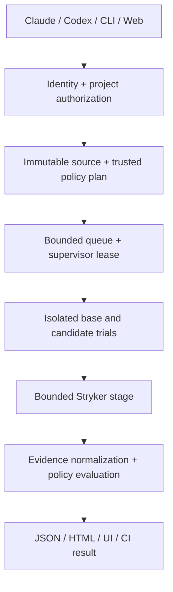

# ProofGate architecture

Decision baseline: 2026-10-25. This document records the design; see [implementation and validation status](STATUS.md) for measured release behavior.

## 1. Product contract

For an immutable candidate change, answer three separate questions:

1. Does the candidate pass the required tests in the registered runner profile?
2. Does a selected regression test distinguish the original behavior from the candidate, with the declared failure observed on the original?
3. Do the selected tests detect controlled mutations of the changed executable code?

Store observations, scope and uncertainty separately. A policy pass means that the recorded checks meet the selected policy. It is not proof that an issue's natural-language requirements are complete, that the whole program is correct, or that a security fix is sufficient.

The differentiator is the connection between these observations and an exact change, with a useful agent workflow. Stryker provides mutation execution; ProofGate will not reimplement its mutation engine.

## 2. Initial support and operating modes

- TypeScript/JavaScript, Node.js 24, npm lockfile and Node-mode Vitest tests in one package. Exact mutually compatible package versions are pinned at the first implementation gate.
- First target: pure/business-logic unit tests and offline tests with local fixtures. Vitest browser mode, general end-to-end services, arbitrary monorepos and other test frameworks are later adapters.
- Linux containers execute project code. Linux and Windows CLI support are release gates; Windows uses Docker Desktop Linux containers. macOS is an intended later verified target, not initially claimed support.
- Local mode is the first usable milestone. It uses local OS identity, a loopback UI and stdio MCP; it needs no cloud account or model API key.
- Team mode is a later delivery stage of the complete release: one self-hosted instance, one host supervisor, trusted registered repositories and a bounded worker queue. It is not public execution of arbitrary hostile repositories.
- A public demo displays bundled synthetic cases. It cannot execute uploaded code, register paths or accept repository URLs.

## 3. Components and stack

Use an npm-workspaces TypeScript repository with strict types and versioned JSON schemas.

| Component | Responsibility |
| --- | --- |
| `packages/contracts` | Input validation, run/evidence schemas, stable reason codes and schema migrations; Zod with generated JSON schema. |
| `packages/core` | Pure planning, state transitions, scope accounting and deterministic policy evaluation. No shell or Docker access. |
| `packages/snapshots` | Git/object inspection, immutable candidate capture and content manifests. Never stages, commits, resets or cleans the user's checkout. |
| `packages/runner` | Trusted host supervisor, resource limits, owned sandbox lifecycle, Vitest/Stryker adapters and normalized observations. |
| `apps/cli` | Project registration, doctor, inspect, plan, verify and report entry points calling the same core. These are planned capabilities, not existing commands. |
| `apps/mcp` | A thin stdio adapter with bounded structured responses. No independent verifier or permission system. |
| `apps/server` | Fastify control API, queue metadata, authorization, audit and authenticated artifact delivery. No Docker socket in the web/API process. |
| `apps/web` | React, Vite and Radix UI; semantic HTML and focused CSS. Use Radix primitives for dialogs, menus and other provided controls. |

SQLite in WAL mode stores bounded single-host local/team state; artifacts live in a scoped data directory. No Redis, external database or hosted identity provider is required. Horizontal workers and PostgreSQL are out of this release's scope.

One supervisor owns each data directory, protected by an exclusive instance lock and expiring job leases. Separate CLI/MCP sessions attach to that owner; starting a new agent session must not create a separate queue or bypass the global execution limit. The API remains a transport/control component, not the Docker execution owner.

Main entities: project, policy-profile version, source snapshot, run, attempt, test identity, mutation, finding, artifact, audit event and worker lease. Team mode adds user, team, membership, invitation, session and project-scoped CLI credentials. Every project, run, artifact and credential belongs to an authorization scope.

## 4. Execution flow

### Capture and planning

The operator registers a canonical repository root and trusted policy outside the candidate tree. MCP receives a project ID, never an arbitrary host path or shell command. Base and candidate are explicit. The candidate may be a commit or a captured working tree: tracked files plus explicitly included new files. Capture reads do not modify the checkout. Concurrent edits invalidate capture and require a retry; mixed snapshots are rejected.

Exclude `.git`, `.proofgate`, secrets, `.env*`, credential files, dependency directories, generated artifacts and all sibling project paths. V1 refuses symlinks, submodules, traversal and case-collision ambiguity rather than following them. Secret exclusion is a bounded guard, not a promise that arbitrary source contains no private data. Full source and raw logs remain local by default.

The run plan binds source manifests, base reference, exact tests, changed-line scope, dependency lock, runner image digest, runtime, environment allowlist, policy version and resource budget. Any change to these inputs creates a new plan. A report from an older snapshot is visibly stale and cannot satisfy the current snapshot's gate.

### Before/after evidence

Run three variants:

| Variant | Production code | Tests | Purpose |
| --- | --- | --- | --- |
| B | Base | Original base tests | Baseline health and pre-existing failures. |
| C | Base | Explicitly selected candidate regression tests and reviewed test-only helpers | Does this test observe the declared original failure? |
| H | Candidate | Candidate tests plus the externally required test scope | Does the candidate satisfy the test and retain required coverage? |

Test transfer into C is a test-only patch in a disposable copy. It cannot transfer implementation files or silently change the base dependencies/configuration. Dependency drift, missing new APIs, failed collection, incompatible helpers or unmatched failures produce `inconclusive`, not evidence of a successful fix.

A selected regression claim is supported only if the exact test is discovered in both C and H, C reproduces the operator-approved assertion-failure signature, and H passes. Runtime/import/setup errors and arbitrary assertion failures do not substitute for that signature. Without an approved failure contract, report a differential observation and leave the stronger bug-fix claim unverified.

The decisive C/H test observations repeat three times in freshly prepared containers. They must agree. This exposes observed instability, but three successes do not establish the absence of flaky behavior. Baseline failures must be individually reviewed in the external profile or block evaluation. H runs the whole registered required suite, not just an inferred subset. Removed/renamed mandatory tests need explicit policy review; a candidate cannot grant itself an exception.

### Mutation evidence

Use StrykerJS and its Vitest runner on a declared bounded set of changed executable locations. Record selected, attempted, omitted and incomplete scope. The plan's mutant count is a cap, not a claim that every possible mutation is examined. The adapter must prove the cap is enforceable before execution; unsupported enumeration/limits fail closed. Never relabel a partial traversal as complete.

Normalize outcomes as detected, survived, uncovered, invalid or unresolved, retaining the original engine status and test attribution. A process crash, timeout, compile error or missing report is never counted as a detected fault. Surviving mutants are review findings; some can be behaviorally equivalent, so they are not automatically real bugs. Do not present Stryker's aggregate score as a proof score.

Stryker runs within its own isolated candidate stage and may reuse its internal workers. The UI must not imply that every mutant had a fresh container. The separately repeated C/H observations have the stronger fresh-container property. Test selection is an optimization with declared limits; static import analysis alone cannot establish complete integration-test coverage.

## 5. Verdict and evidence format

Execution state and policy verdict are separate. States cover queued, preparing, running, collecting, completed, canceled and interrupted. Verdicts are `pass`, `fail` and `inconclusive`, with per-check reason codes and not-applicable measurements.

- `pass`: all required checks in the declared scope complete and satisfy the frozen profile. The initial alpha has no mutation-waiver mechanism; survived/uncovered mutations remain failures. Any future exception must be explicitly reviewer-bound.
- `fail`: a conclusive required check fails or an unreviewed policy finding remains.
- `inconclusive`: a required observation is missing, unstable, unsupported, interrupted, over budget or blocked by infrastructure. If another check conclusively fails, retain both observations; the aggregate can fail while still listing incomplete checks.

Zero discovered required tests cannot pass. Limits, canceled runs, missing Docker and unsupported projects have explicit reasons. CI succeeds only for `pass`. Planned CLI exit codes: 0 pass, 1 fail, 2 inconclusive, 130 user cancellation.

An evidence bundle includes schema/tool versions, snapshot and lock digests, image digest, profile, environment fingerprint without secret values, trial/test identities, expected and observed failures, mutant outcomes, scope/budget accounting, sanitized logs and artifact hashes. The supervisor records its envelope outside candidate-writable paths. It stores only allowlisted, size-bounded plain regular files as artifacts, escapes HTML, and rejects symlinks and path escapes during collection.

Hashes bind bytes and detect changes when compared. They do not make a report tamper-proof against the host administrator or a malicious test suite. Project tests, dependencies and reporters are executable code; V1 does not promise resistance to intentional evidence forgery inside a hostile repository. Hosted hardware attestation is out of scope.

## 6. Isolation, cost and lifecycle

Only the trusted supervisor controls Docker. It accepts a typed manifest and independently enforces registered roots, permitted image digests, known argument vectors and hard budget ceilings. The API, MCP tool caller and candidate cannot supply shell fragments, host mounts, elevated container settings or additional repository roots.

Trials run as non-root, with no network, no Docker socket, no host PID namespace, dropped capabilities, no-new-privileges, a read-only root and a bounded writable scratch area. The immutable input snapshot is read-only; a disposable in-container copy supports tests/build output. Do not forward host credentials, browser profiles, tokens or the full process environment.

Dependency preparation is a distinct planned step: lockfile/integrity-bound public npm packages, lifecycle scripts disabled by default, a controlled registry network phase without credentials, then a sealed dependency image. Private packages, git dependencies and packages requiring unreviewed installation scripts are initially unsupported. Network isolation during verification does not imply that package preparation needed no network.

Initial ceilings are design defaults, not measured performance: one active run per supervisor, 2 CPU, 2 GiB memory, 256 PIDs, 256 MiB scratch, 120 seconds per stage and 10 minutes per run, with at most 25 planned mutants. Runtime budgets are enforced independently of reported test completion. A required stage that cannot finish within its budget is inconclusive. Hosts may lower the ceilings; changing the profile records a new version.

Cancellation terminates all owned processes/containers, records incomplete evidence and preserves the checkout. Cleanup uses canonical owned roots plus run markers and container labels, never broad host enumeration/deletion. A lease expired by restart becomes interrupted; resume is explicit and creates fresh attempts. Default raw-artifact retention is seven days, configurable within the owning scope.

No verdict caching in the initial milestone. Later reuse must bind the full source/tests/helpers/config/lock/runtime/image/policy/environment identity. Always repeat decisive C/H observations fresh. Stryker's own incremental cache alone is insufficient to detect all environment changes.

Docker reduces exposure but shares a kernel. This design supports trusted registered projects and a self-hosted small team, not unrestricted adversarial code execution as a public multi-tenant service.

## 7. Agent integration and access control

Planned MCP tools: `inspect_change`, `plan_verification`, `start_verification`, `get_verification`, `cancel_verification`, `get_evidence`. Plans and responses have schema validation, stable IDs, size limits and pagination. Raw log text is untrusted data and never becomes an instruction. Read tools cannot start jobs. Starting/canceling is scoped to the authenticated local identity and registered project; caller-supplied user/team labels cannot establish identity.

Ship thin separate Codex and Claude Code packages around one local stdio MCP implementation. Use packaged workflow instructions and explicit tools for the essential path. Lifecycle hooks are optional later conveniences. Current Codex documentation restricts hook-containing public-directory packages; GitHub/manual distribution and marketplace approval are separate publication paths. Do not promise public-directory acceptance or web access to a user's local files.

Local UI: loopback binding, Host/Origin allowlist, short-lived bootstrap exchange, HttpOnly SameSite cookies and CSRF protection. No open CORS or unauthenticated execution endpoint. Treat other browser pages as untrusted even on localhost.

Team stage: HTTPS, no default credentials or public signup, expiring single-use invitations, server-side membership checks and owner/admin/member/viewer roles. Viewers cannot launch jobs; profile/root/image changes require administration. Password hashing uses async scrypt with bounded concurrency; session and invitation tokens are random and persisted only as digests. Cookie sessions expire and revoke on sensitive identity changes. Project-scoped CLI tokens expire and can be revoked. Account recovery is an operator-issued, expiring single-use flow; SMTP, MFA and SSO are deferred features. User/team IDs from requests never override authenticated membership. Every run, artifact and audit query checks scope; changing membership affects new reads/actions immediately.

## 8. Interface and testable acceptance

The primary screen is a change review: changed code, the stated claim, observed before/after results and outstanding evidence. Put the exact verified snapshot and scope near the verdict. Expand into test and mutation details instead of adding decorative dashboard metrics.

Required UI behaviors: keyboard access, visible focus, semantic labels, readable contrast, status words in addition to color, reduced-motion support, Turkish/English copy, narrow-screen access, bounded live updates and virtualized long lists where needed. Accessibility claims require verification; no untested WCAG conformance statement.

Release gates must exercise actual processes/containers and HTTP boundaries:

1. A real fix has the declared assertion failure in C and passes in H across all three fresh trials.
2. A weak regression test that passes on both variants does not validate the fix.
3. Import errors, setup crashes, timeouts, zero-test collection, budget exhaustion and observed flakiness cannot produce a pass for the affected required claim.
4. A lost dependency/config match is reported as incompatible differential execution.
5. Removed mandatory tests, skip/only additions, snapshot updates and changed test/mutation exclusions appear as policy changes, with no candidate-authored silent override.
6. A surviving or uncovered selected mutation is reported accurately; an invalid mutant is not counted as detected. Future equivalent-mutant exceptions must bind a reviewer to the relevant profile and source identity; the alpha does not accept them.
7. Source mutation after capture makes the current workspace status stale; no old report is attached to different bytes.
8. Docker network/file/resource limits, output artifact path checks, cancellation, restart leases and owner-scoped cleanup are actually exercised.
9. MCP rejects unregistered projects, shell/path injection, oversized requests and forged identities; the adapter's supported bounded mutation planning is demonstrated against the pinned engine version.
10. Local HTTP origin/auth/CSRF rules and cross-team/role/invitation/session boundaries have meaningful negative tests.
11. A clean source install runs the synthetic examples and produces matching JSON/HTML/UI verdicts. Windows/Linux checks and the supported Docker path pass.
12. The public demo runs only built-in cases; TR/EN setup, limitations, security reporting and contribution docs match real behavior.

The first deliverable is an engine vertical slice with these negative outcomes represented. A polished UI without a real verifier does not complete a milestone. Performance numbers and test counts are published only from measured runs.

## 9. Primary sources consulted

Checked 2026-10-25. External behavior is compatibility input; the product decisions above are our design choices.

- [OpenAI Docs: plugin packaging](https://developers.openai.com/plugins/build/plugins): MCP/skill packaging and hook distribution limits.
- [Claude Code: plugins](https://code.claude.com/docs/en/plugins): plugin components and MCP integration.
- [Stryker Vitest runner](https://stryker-mutator.io/docs/stryker-js/vitest-runner/): use the existing adapter; its documented scope excludes browser mode.
- [Stryker incremental mode](https://stryker-mutator.io/docs/stryker-js/incremental/): environment-sensitive cache limitations.
- [Vitest CLI](https://vitest.dev/guide/cli.html): static dependency selection has limits.
- [MCP security guidance](https://modelcontextprotocol.io/specification/latest/basic/security_best_practices): local-server and transport boundaries.
- [Docker security](https://docs.docker.com/engine/security/): supervisor/daemon privilege boundary and container limitations.
