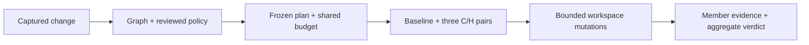

# RFC: controlled npm workspace execution

[Türkçe](WORKSPACE-EXECUTION-RFC.tr.md) · [Current preflight](WORKSPACE-IMPACT.md) · [Existing architecture](ARCHITECTURE.md)

**Status: proposed, awaiting architecture approval. No execution support implemented.** Prepared 2026-10-29 against local source commit `197ae3a72c1a4739d39f0f0d01a8d1f793171449`, version `0.1.0-alpha.2`. VoiceBridge model conversion is deferred, not accepted as a quality fix.

## Decision and product result

Extend the existing read-only workspace graph into an explicit verification plan for a bounded npm/Vitest monorepo. Show which changed packages and consumers were tested, why they were selected, whether the regression fails on the original, and whether consumer tests detect mutations in shared code. A green result for one member must not hide missing evidence for another.

The existing service rejects workspace execution in `apps/server/src/service.ts`. `packages/runner/src/dependencies.ts` rejects workspace manifests and every linked lock entry. The sandbox currently links whole dependency directories to its immutable dependency image, and the reporter identifies tests only by full name. All four boundaries need deliberate changes; removing the service rejection alone is not the feature.

## First supported profile

| Item             | Proposed bound                                                                                      |
| ---------------- | --------------------------------------------------------------------------------------------------- |
| Target           | Node-mode JavaScript/TypeScript, npm lockfile v3, Vitest 5.0.5 and Stryker 10.1.1                   |
| Executed members | At most five, under one captured Git root; root is administrative                                   |
| Source capture   | Existing 500 files, 512 KiB/file and 4 MiB total; no increase                                       |
| Test policy      | External, reviewed policy v2; at most 30 standalone test files and 200 required identities globally |
| Trials           | One workspace baseline B and three fresh C/H pairs: seven trial containers total                    |
| Resources        | Existing single supervisor, one active container, two CPUs, 2 GiB memory, bounded scratch           |
| Budgets          | At most 120 seconds/stage, 600 seconds for the whole job, 25 selected mutants globally              |

Initial execution permits implementation/test edits inside declared members. Root/member manifests, lockfile, workspace names/paths, build/test configuration and dependency topology must remain identical between base and candidate. Package addition/deletion/rename, cycles, shared-root executable changes, unknown graph edges, unsupported lock links or exceeding the selection cap block execution with an explicit reason. Read-only inspection continues to show such changes. This restriction is an engineering choice for the first slice, not a claim that these repositories are invalid.

No pnpm/Yarn adapter, browser/E2E tests, private registry, lifecycle/build scripts, arbitrary candidate configuration, automatic fixes or cross-product integration. Members must expose source usable by the reviewed Node test profile without a build stage. External dependencies must remain public-registry and integrity pinned. Accept generated npm workspace links only when they exactly match captured member names/paths; no arbitrary `file:` or outside-root links. The initial dependency layout is root-hoisted; member-specific external dependency trees are explicitly unsupported.

Use array-form workspace declarations and the preflight's supported literal/whole-component `*`/`**` patterns. The initial execution profile rejects `workspace:` dependency tokens and uses real npm-generated lock/link fixtures with ordinary local version references. The inspector's broader parsing is not installation support. Record the exact npm version from the immutable runner image in the plan; do not upgrade npm during preparation. This remains a registered-project container workflow, not unrestricted hostile-code hosting.

## Frozen plan and policy

Selection includes every affected member in the existing before/after reverse closure, plus externally mandatory members. No caller can remove an affected member. An incomplete graph blocks execution. Unselected captured members remain visible as unverified; the graph is not proof of runtime/import completeness.

An external v2 profile specifies member paths, baseline tests, required candidate tests, standalone transferable regression files, one approved failure signature and changed production scope. Test identity is `(member path, repository-relative file, full test name)`. Missing/duplicate identity, a required member with no baseline/required tests, or a removed mandatory test cannot pass. Existing v1 profiles/evidence retain their behavior and schema.

The plan hash binds canonical base/candidate snapshots, graph and reason chains, selected/unselected members, external policy, exact transferred test bytes, all installation manifests, unchanged lock, local-link map, runner/dependency image digests, adapter/tool versions, environment and shared budgets. The image cache key must include that manifest/link/profile identity, not just the root lock hash.

Recheck sources, policy, images, caller role and lease before enqueueing and again before execution. Any mismatch requires a new plan. Workspace inspection creates neither a plan nor a job. Read-only demo and viewer access remain unable to start execution.

## Execution and the local-link gate

Dependency preparation is a separate reviewed operation with install scripts disabled. Record immutable images and the exact installation topology. Target code runs later only in the existing offline, read-only-root, non-root container boundary; no Docker socket or target scripts are added to the web process.

The trusted sandbox bootstrap materializes its own `node_modules` namespace. External modules can point to the immutable dependency image. Workspace links must point to the **current variant's captured source**. Scoped directories must be materialized member by member, not linked wholesale to an image directory that contains stale workspace links. Only links derived from the frozen map are generated; captured user symlinks remain forbidden.

Stryker's current `symlinkNodeModules: true` path cannot be assumed correct for a copied mutation sandbox. The first mandatory integration spike must rebuild/validate local links relative to each actual mutation sandbox before delegating to the pinned official Vitest runner. Prefer the supported plugin/bootstrap API; no private monkey patch is approved. If that API cannot provide a safe integration, stop and revise this part of the architecture. Do not ship a silent fallback to original/unmutated source.

Proof: a controlled mutation in `packages/access` must be detected by a selected test in its consumer `apps/api`; log the resolved module path and exact mutation/test identities in synthetic evidence. Also demonstrate distinct B/C/H implementations. Without this real-container proof, workspace execution stays disabled.

Use a generated trusted Vitest `projects` configuration with unique member names, explicit files and Node environment. Do not discover candidate configuration or run `npm test` scripts. Set no watch/retry, no file parallelism, one worker and `passWithNoTests: false`. Verify actual discovery per required member independently of process exit. Package-specific working directories are not implicitly assumed.

B uses registered original baseline tests. C uses original implementation plus only approved standalone candidate regression files; implementation/manifests/dependencies cannot be transferred. H uses candidate implementation and the whole frozen required scope. C must show the exact approved assertion failure for the same regression identity that passes in H. Import/setup failure, unavailable new API, zero tests, skip or unstable repeated results remain non-pass evidence.

Mutation selection/caps apply to the whole job, never 25 per member. The official Stryker engine and Vitest runner remain in use, with `related: false` for the full required selected suite. Incomplete selection/execution, missing reports or budget exhaustion cannot be relabeled complete. Each mutant retains its member/file/location/operator and detecting test identities.

## Evidence, interfaces and acceptance

A workspace evidence v2 envelope records plan identity, member reasons, seven trial observations, per-member discoveries/findings, global mutation accounting and all omissions. Aggregate pass requires every mandatory check in every selected member; conclusive failures and incomplete checks both remain visible. No averaged package score. CLI, MCP and UI consume the same envelope. Oversized MCP results return an authenticated artifact reference or explicit size error, not truncated success. Existing v1 reports remain readable.

The UI extends the existing review flow using its Radix primitives: selection reasons, frozen scope/plan, shared budget, per-member status and unverified members. Show TR/EN status words and source identity near the verdict. No new account system or decorative metrics.

Release acceptance must demonstrate in actual containers: strong fix; weak test passing on C/H; consumer-detected shared mutation; zero/duplicate/missing tests; deleted/cyclic/unknown topology; changed manifests/locks/config; stale plan/policy/image; unsafe local links; import/setup crash; mutation cap; timeout/cancel; restart and role revocation; cross-team artifact denial; one global queue; CLI/MCP/UI identity agreement; and fresh-source Windows/Linux checks. Preserve all current single-package gates and synthetic evidence.

Delivery order after approval: (1) v2 contracts/pure planner; (2) dependency/link and cross-package mutation spike; (3) seven-trial execution/global evaluation; (4) CLI/MCP/UI, docs and recorded read-only demo; (5) full CI, source installation and an alpha.3 release only when the gates pass. Existing alpha.2 assets are immutable. There is no schedule or quality guarantee. This RFC contains no implementation or new execution evidence.

## Compatibility sources

These inform the design; local integration still needs execution proof:

- [npm workspaces](https://docs.npmjs.com/cli/v11/using-npm/workspaces/): installation links local members into the dependency namespace.
- [Vitest projects](https://vitest.dev/guide/projects.html): named test projects and working-directory behavior.
- [Vitest CLI](https://vitest.dev/guide/cli.html): explicit collection, no-test and worker controls.
