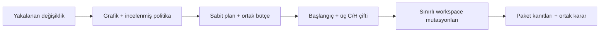

# RFC: kontrollü npm workspace yürütmesi

[English](WORKSPACE-EXECUTION-RFC.md) · [Mevcut ön inceleme](WORKSPACE-IMPACT.md) · [Mevcut mimari](ARCHITECTURE.md)

**Durum: onaylandı; alpha.3 için uygulandı.** Mimari onayı 29 Ekim 2026 tarihinde alındı. [Kullanım](WORKSPACE-EXECUTION.tr.md) ve [gerçek konteyner kanıtı](../examples/evidence/WORKSPACE-PROVENANCE.md). İlk tasarım bağlamı: 29 Ekim 2026; incelenen yerel kaynak `197ae3a72c1a4739d39f0f0d01a8d1f793171449`, sürüm `0.1.0-alpha.2`. VoiceBridge model dönüştürmesi ertelendi; kalite düzeltmesi tamamlanmış sayılmıyor.

## Karar ve ürün sonucu

Salt okunur workspace grafiğini sınırlı npm/Vitest monoreposu için açık doğrulama planına bağlamak. Hangi değişen paketlerin ve tüketicilerinin neden seçildiği, regresyon testinin eski kodda hatayı gösterip göstermediği ve tüketici testlerinin ortak kod mutasyonunu yakalayıp yakalamadığı görülecek. Bir paketin yeşil sonucu diğerindeki eksik kanıtı gizleyemeyecek.

Bu genişletmeden önce `apps/server/src/service.ts` workspace yürütmesini engelliyordu. `packages/runner/src/dependencies.ts`, workspace bildirimlerini ve bütün bağlantılı lock girişlerini reddediyor. Sandbox bağımlılık dizinlerini değişmez imaja bağlıyor; reporter testleri yalnızca tam adlarıyla tanıyor. Dört sınır birlikte ele alınmalı; yalnızca servis engelini kaldırmak özellik sayılmaz.

## İlk desteklenen profil

| Konu               | Önerilen sınır                                                                               |
| ------------------ | -------------------------------------------------------------------------------------------- |
| Hedef              | Node ortamında JavaScript/TypeScript; npm lockfile v3, Vitest 5.0.5, Stryker 10.1.1          |
| Çalıştırılan paket | Tek yakalanmış Git kökü altında en fazla beş; kök yönetim amaçlı                             |
| Kaynak             | Mevcut 500 dosya, dosya başına 512 KiB, toplam 4 MiB; artırılmıyor                           |
| Test politikası    | Haricî, incelenmiş v2 profil; toplam en fazla 30 bağımsız test dosyası ve 200 zorunlu kimlik |
| Deneme             | Bir workspace B başlangıcı + üç taze C/H çifti; toplam yedi konteyner                        |
| Kaynak kullanımı   | Mevcut tek supervisor, aynı anda bir konteyner, iki CPU, 2 GiB bellek, sınırlı scratch       |
| Bütçe              | Aşama başına en fazla 120 saniye; bütün işe 600 saniye ve toplam 25 seçilmiş mutasyon        |

İlk yürütme, tanımlı paketler içindeki uygulama/test düzenlemelerini kabul eder. Kök/paket bildirimleri, lockfile, paket adları/yolları, build/test yapılandırması ve bağımlılık topolojisi eski/aday arasında aynı kalmalı. Paket ekleme/silme/taşıma, döngü, ortak kökte çalıştırılabilir değişiklik, belirsiz grafik, desteklenmeyen lock bağlantısı veya seçim sınırını aşma açık gerekçeyle yürütmeyi engeller. Salt okunur inceleme bunları göstermeye devam eder. Bu ilk dilimin mühendislik sınırıdır; söz konusu depoların hatalı olduğu iddiası değildir.

pnpm/Yarn, browser/E2E, özel registry, lifecycle/build betikleri, adayın keyfî yapılandırması, otomatik düzeltme veya ürünler arası entegrasyon yok. Paket kaynakları incelenmiş Node test profiliyle build aşaması olmadan kullanılabilmeli. Haricî bağımlılıklar açık npm registry ve sabit bütünlük değerleriyle sınırlı. npm'nin ürettiği yerel bağlantılar yalnızca yakalanmış paket adı/yoluyla tam eşleşirse kabul edilir; keyfî `file:` veya kök dışı bağlantı olmaz. İlk bağımlılık düzeni kökte toplanmış bağımlılıklardır; paket başına ayrı haricî bağımlılık ağaçları desteklenmez.

Workspace tanımı dizi biçiminde; kalıplar ön incelemenin desteklediği tam yol parçaları ve `*`/`**` ile sınırlı olur. İlk yürütme profili `workspace:` bağımlılık sözcüğünü reddeder; gerçek npm'nin ürettiği lock/bağlantı örnekleri ve olağan yerel sürüm başvuruları kullanılır. İnceleyicinin daha geniş ayrıştırması kurulum desteği değildir. npm sürümü kanıta kaydedilir; değişmez runner imajı plana bağlanır; hazırlama sırasında yükseltilmez. Bu kayıtlı projeye ait konteyner akışıdır, sınırsız düşmanca kod barındırma hizmeti değildir.

## Sabit plan ve politika

Seçim, mevcut önce/sonra ters bağımlılık kapanışındaki bütün etkilenen paketleri ve haricî politikada zorunlu paketleri kapsar. Çağıran etkilenen paketi çıkaramaz. Eksik grafik yürütmeyi durdurur. Seçilmemiş yakalanan paketler doğrulanmamış olarak görünür; grafik çalışma zamanı/import eksiksizliğinin kanıtı değildir.

Haricî v2 profil; paket yolları, başlangıç testleri, zorunlu aday testleri, aktarılabilir bağımsız regresyon dosyaları, onaylı hata imzası ve değişen üretim kapsamını tanımlar. Test kimliği `(paket yolu, depo içi dosya, tam test adı)` olur. Eksik/yinelenen kimlik, başlangıç/zorunlu testi olmayan gerekli paket veya kaldırılan zorunlu test geçemez. Mevcut v1 politika ve kanıtların davranışı/şeması korunur.

Plan özeti; kanonik eski/aday görüntülerini, grafiği/gerekçe zincirlerini, seçilen/seçilmeyen paketleri, haricî politikayı, aktarılan test baytlarını, bütün kurulum bildirimlerini, değişmeyen lock'u, yerel bağlantı haritasını, runner/bağımlılık imajı özetlerini, adaptör/araç sürümünü, ortamı ve ortak bütçeleri bağlar. İmaj önbelleği yalnızca kök lock özetiyle değil bu bildirim/bağlantı/profil kimliğiyle anahtarlanmalı.

Kuyruğa almadan ve yürütmeden önce kaynak, politika, imaj, çağıranın rolü ve iş sahipliği yeniden denetlenir. Değişiklik yeni plan gerektirir. Workspace incelemesi plan/iş oluşturmaz. Salt okunur demo ve viewer yürütme başlatamaz.

## Yürütme ve yerel bağlantı kapısı

Bağımlılık hazırlama ayrı, incelenmiş işlemdir; kurulum betikleri kapalı kalır. İmaj ve tam kurulum topolojisi kaydedilir. Hedef kod daha sonra yalnızca mevcut çevrimdışı, kökü salt okunur, root olmayan konteyner sınırında çalışır; web işlemine Docker socket veya hedef betik eklenmez.

Güvenilir sandbox başlangıcı kendi `node_modules` ad alanını oluşturur. Haricî modüller değişmez bağımlılık imajına bağlanabilir. Workspace bağlantıları **o anki varyantın yakalanmış kaynağına** gitmeli. Kapsamlı paket dizinleri, imajdaki eski yerel bağlantıları taşıyan üst dizine topluca bağlanmamalı; üye üye oluşturulmalı. Yalnızca sabit haritadan bağlantı üretilir; kullanıcı symlink yakalaması yasak kalır.

Stryker'ın mevcut `symlinkNodeModules: true` yolunun kopyalanmış mutasyon sandbox'ında doğru olduğu varsayılmaz. İlk zorunlu entegrasyon denemesi; sabit resmî Vitest runner'ına devretmeden önce, gerçek mutasyon sandbox'ı içinde yerel bağlantıları yeniden oluşturup doğrulamalı. Desteklenen plugin/başlangıç API'si tercih edilir; özel iç API yaması onaylanmaz. Güvenli entegrasyon bu API ile yapılamıyorsa bu mimari parça yeniden değerlendirilir. Eski veya mutasyonsuz kaynağa sessiz geçiş yayımlanmaz.

Kanıt: `packages/access` içindeki kontrollü mutasyon, tüketicisi `apps/api` testince yakalanmalı. Sentetik kanıtta çözümlenen modül yolu ve mutasyon/test kimlikleri kaydedilir. B/C/H'nin farklı uygulamaları kullandığı da gösterilir. Bu gerçek konteyner kanıtı olmadan workspace yürütmesi açılmaz.

Üretilen güvenilir Vitest `projects` yapılandırması; benzersiz paket adları, açık dosyalar ve Node ortamı kullanır. Aday yapılandırması keşfedilmez, `npm test` betiği çalıştırılmaz. Watch/retry ve dosya paralelliği kapalı, worker bir, `passWithNoTests: false` olur. Her zorunlu paketin gerçek test keşfi işlem çıkışından bağımsız denetlenir. Paketlerin çalışma dizininin kendiliğinden değiştiği varsayılmaz.

B, kayıtlı eski başlangıç testlerini çalıştırır. C, eski uygulama ile yalnızca onaylı bağımsız aday regresyon dosyalarını birleştirir; uygulama/bildirim/bağımlılık aktarılamaz. H, aday uygulamayı ve sabit zorunlu kapsamın tamamını çalıştırır. C'de aynı regresyon kimliği için onaylı assertion hatası görülmeli, H'de test geçmeli. Import/setup hatası, yeni API'nin eski kodda bulunmaması, sıfır test, skip veya tekrarlarda değişken sonuç başarı yerine geçmez.

Mutasyon seçimi/sınırı tüm iş içindir; paket başına 25'e dönüşmez. Resmî Stryker ve Vitest runner korunur; `related: false` ile seçili zorunlu testlerin tamamı kapsanır. Eksik seçim/yürütme, rapor kaybı veya bütçe tükenmesi tamamlandı diye sunulmaz. Her mutasyon paket/dosya/konum/operatör ve yakalayan test kimliklerini korur.

## Kanıt, arayüz ve kabul

Workspace kanıt zarfı v2; plan kimliği, paket gerekçeleri, yedi deneme, paket bazlı keşif/bulgu, ortak mutasyon muhasebesi ve bütün eksikleri içerir. Toplu geçiş için her seçilmiş paketin bütün zorunlu kontrolleri tamamlanmalı. Kesin hatalar ve eksik kontroller birlikte görünür; paket skorlarının ortalaması alınmaz. CLI, MCP ve panel aynı zarfı kullanır. Büyük MCP çıktısı kimlik denetimli artifact referansı veya açık boyut hatası verir; kırpılmış başarı olmaz. Eski v1 rapor okunur kalır.

Panel, mevcut Radix bileşenleriyle inceleme akışını genişletir: seçim gerekçeleri, sabit kapsam/plan, ortak bütçe, paket durumları ve doğrulanmayan paketler. Kararın yanında TR/EN durum sözcükleri ve kaynak kimliği görünür. Yeni hesap sistemi veya dekoratif metrik eklenmez.

Gerçek konteyner kabulü: güçlü düzeltme; C/H'de de geçen zayıf test; tüketicinin ortak mutasyonu yakalaması; sıfır/yinelenen/eksik test; silinmiş/döngülü/belirsiz topoloji; bildirim/lock/config değişimi; eski plan/politika/imaj; uygunsuz yerel bağlantı; import/setup çökmesi; mutasyon sınırı; süre/iptal; yeniden başlatma ve rol iptali; ekipler arası artifact reddi; tek kuyruk; CLI/MCP/panel kimlik eşleşmesi ve temiz kaynak Windows/Linux kontrolleri. Tek paketli mevcut kapılar ve sentetik kanıt korunur.

Onaydan sonraki sıra: (1) v2 sözleşme/saf planlayıcı; (2) bağımlılık/bağlantı ve paketler arası mutasyon denemesi; (3) yedi deneme/ortak değerlendirme; (4) CLI/MCP/panel, belgeler ve kayıtlı salt okunur demo; (5) tam CI, temiz kurulum ve kapılar geçerse alpha.3. Eski alpha.2 varlıkları değişmez. Süre veya kalite garantisi verilmez. Tasarım uygulandı; gözlenen sonuçlar ve sınırlar bağlantılı doğrulama belgelerindedir.

## Uyumluluk kaynakları

Bunlar tasarımı bilgilendirir; yerel entegrasyon yine çalıştırılarak doğrulanmalı:

- [npm workspaces](https://docs.npmjs.com/cli/v11/using-npm/workspaces/): kurulum yerel paketleri bağımlılık ad alanına bağlar.
- [Vitest projects](https://vitest.dev/guide/projects.html): adlandırılmış projeler ve çalışma dizini davranışı.
- [Vitest CLI](https://vitest.dev/guide/cli.html): açık keşif, sıfır test ve worker kontrolleri.
